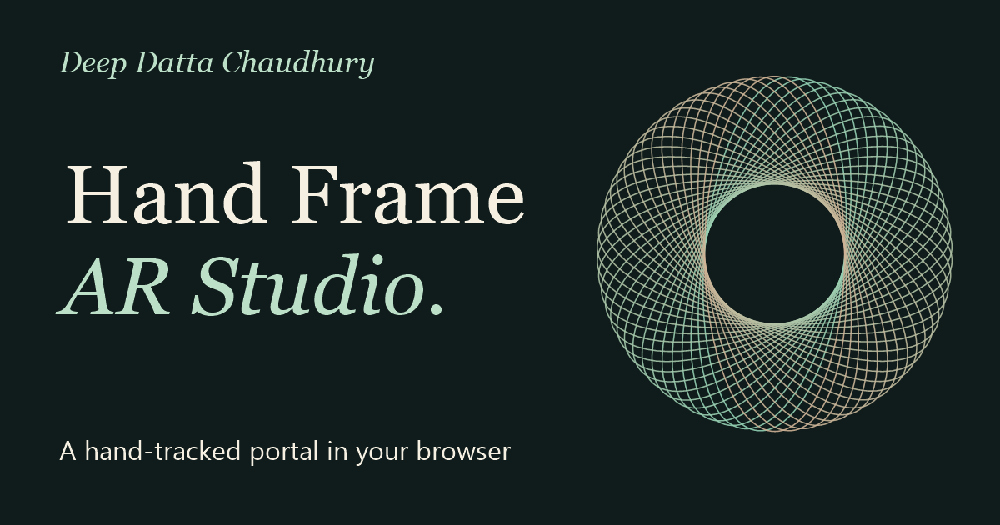

# Hand Frame AR Studio

Make an L with each hand and a glowing name portal appears between your fingers. Move or tilt your hands and the portal follows. On the opening screen, **Try it without a camera** lets visitors explore the effect before granting camera access.

## Try it locally

With Python 3 installed, open a terminal in this repository and run:

    python -m http.server 8000 --bind 127.0.0.1 --directory docs

Open http://localhost:8000 in Chrome or Edge. On macOS or Linux, substitute python3 for python. Press Ctrl+C in the terminal to stop. The ready-to-run build includes its models and WebAssembly runtime.

## Use a webcam or phone

1. Select **Start camera** and allow camera access.
2. Choose a device under **Camera source**. For Iriun, connect the phone to the desktop app and refresh the list.
3. Show both palms with index fingers pointing up and thumbs pointing toward each other. Spread your hands until the frame locks.
4. Open **More effects** to try a character picture, face photo, or local image or video. Camera frames and selected files are processed in the browser.

## Publish the demo

1. Create an empty public GitHub repository named hand-frame-ar-studio.
2. Upload the contents of this folder so README.md, package.json, src/ and docs/ sit at the repository root. Using Git or GitHub Desktop also preserves dotfiles.
3. Under **Settings → Pages → Build and deployment**, select **Deploy from a branch**, **main**, and **/docs**, then save.
4. After deployment, use **Visit site** on the Pages screen. Paste that HTTPS address into LinkedIn. To share a visual separately, attach public/studio-cover.png or record the running app.

## Develop

With Node.js 22 and npm installed, run npm ci and then npm run dev. Installation downloads the tracking models and copies the runtime into public/. After editing, run npm run build and commit the regenerated docs/ directory along with your source changes.

## How the effect works

MediaPipe tracks the hands. The app checks the thumb and index fingertips for two L shapes, smooths the four corners, and perspective-warps a Canvas animation onto the opening. The camera-free preview renders the same name effect in a simulated frame.

## Credits

Personalized portfolio edition by Deep Datta Chaudhury, adapted from [sreevar2005/hand-frame-ar](https://github.com/sreevar2005/hand-frame-ar). The original project provides the gesture detection, tracking, and effect pipeline. This edition adds the orbital line animation, name treatment, camera switching, studio interface, and camera-free preview. Hand and face tracking use Google MediaPipe. See the upstream repository for its licensing information before redistributing the adaptation.
